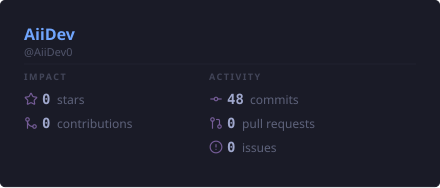

# 👋 Hola, soy Aiberson Montilla
### 🚀 Full-Stack Developer & SaaS Builder

  <i>Construyo sistemas robustos, plataformas SaaS y automatizaciones con Next.js, Node.js y Supabase. Desde Venezuela 🇻🇪 para el mundo.</i>

 

### 💻 Sobre mí
- 🚀 Acabo de lanzar **[Booking-Core](https://bookingc.aibersondev.cv)**, un SaaS de gestión de citas para negocios.
- 🔭 Actualmente estoy construyendo herramientas para la comunidad de **Discord** y **Node.js**.
- 🌱 Siempre aprendiendo sobre arquitecturas limpias, seguridad en el backend y monetización de software.
- 💬 Pregúntame sobre **Next.js, TypeScript, Discord.js, Supabase o automatizaciones**.
- 📫 Contáctame a través de mi **[Portafolio Web](https://aibersondev.cv/contacto/)**.

 

### 🌟 Proyectos Destacados

**📅 [Booking-Core](https://bookingc.aibersondev.cv)** *(En Producción)*
SaaS completo de gestión de citas. Incluye páginas públicas de reserva, panel de administración, cancelación autónoma por correo, límites de planes y diseño 100% responsive.
*(Next.js · Supabase · Tailwind CSS · Resend)*

**🛡️ [Envy-Core](https://www.npmjs.com/package/envy-core)**
Validador y auditor de seguridad de variables de entorno para Node.js. Encriptación AES-256, bloqueo de producción y escáner de Git.
*(TypeScript · Node.js · CLI)*

**🎫 [TicketBot Core](https://aiberson.gumroad.com/l/ticketbot-core)**
Sistema profesional de tickets para Discord. Panel interactivo, prioridades, transcripts HTML y calificaciones de staff.
*(Node.js · Discord.js · MongoDB)*

 

### 🛠️ Tecnologías y Herramientas

  

 

### 📊 Mis Estadísticas en GitHub

  
  
  

 

  <i>"El código limpio no es el que se escribe rápido, sino el que se lee fácil."</i>

